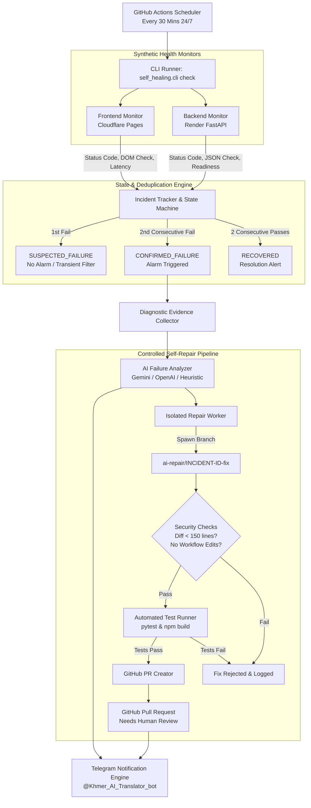

# KHMER TRANSLATOR AI — AUTONOMOUS SELF-HEALING SYSTEM
## 24/7 Cloud Monitoring, AI Diagnosis, Controlled Repair, and Telegram Notifications

---

## 1. Executive Architecture Overview

The Khmer Translator Autonomous Self-Healing System provides 24/7 continuous cloud health monitoring, automated diagnostic collection, AI-powered root cause analysis, isolated Git branch repair, regression testing, and instant Telegram incident notifications without requiring your local workstation to stay powered on.



---

## 2. Core Components Directory Structure

```
self_healing/
├── __init__.py                # Package root
├── config.py                  # Environment config, constants, secret redactor
├── models.py                  # Pydantic & dataclass schemas (Incident, CheckResult, etc.)
├── cli.py                     # Unified CLI entrypoint (check, status, test-notify)
├── monitors/
│   ├── __init__.py
│   ├── frontend_monitor.py    # Cloudflare Pages synthetic HTTP/DOM validator
│   └── backend_monitor.py     # Render FastAPI /api/health and /api/ready validator
├── state/
│   ├── __init__.py
│   └── tracker.py             # Incident deduplication, state machine, atomic persistence
├── diagnostics/
│   ├── __init__.py
│   └── collector.py           # Runtime diagnostics, HTTP snippets, Git context
├── ai/
│   ├── __init__.py
│   ├── base.py                # Abstract Base AI Provider
│   ├── gemini_provider.py     # Google Gemini API integration
│   ├── openai_provider.py     # OpenAI-compatible API integration
│   └── analyzer.py            # Failure classification & structured diagnosis
├── repair/
│   ├── __init__.py
│   ├── worker.py              # Isolated branch creation, diff validator, test runner
│   └── pr_creator.py          # GitHub Pull Request creator targeting main
├── notifications/
│   ├── __init__.py
│   ├── formatter.py           # Telegram alert template with Cambodia time (UTC+7)
│   └── telegram.py            # Telegram Bot API client with rate limit handling
└── tests/
    ├── test_models_and_config.py
    ├── test_monitors.py
    ├── test_state_and_deduplication.py
    ├── test_telegram.py
    ├── test_ai_and_diagnostics.py
    └── test_repair_and_safety.py
```

---

## 3. Strict Security & Production Protection Boundaries

1. **Production Branch Immobility:**
   - Automated repairs **never** push directly to `main` or `master`.
   - All AI-generated fixes are isolated onto dedicated `ai-repair/{incident_id}-fix` branches.
   - An automated fix **never** auto-merges or auto-deploys. A human maintainer must review and approve the Pull Request.
2. **Forbidden Repair Targets:**
   - The self-repair worker strictly forbids edits to GitHub Actions workflows (`.github/workflows/`), `render.yaml`, `Dockerfile`, `.env`, and secret configs. Any attempt is automatically rejected.
3. **Diff Threshold Enforcement:**
   - Diffs larger than 150 lines are rejected to prevent massive, uncontrolled refactors during incident response.
4. **Credential Scrubbing:**
   - All diagnostic logs, error payloads, and Telegram alerts pass through `redact_secrets()`, ensuring Telegram bot tokens, GitHub tokens, Bearer headers, and API keys are scrubbed before transmission.
5. **Cold-Start Heuristics:**
   - Render web services on free/sleeping plans experience 60–100s wake-up times. A single cold-start delay or transient 502 triggers `SUSPECTED_FAILURE` and re-probes before confirming an outage, preventing false alarm spam.

---

## 4. Telegram Notification System

### 4.1 Verified Bot Identity
- **Bot Name:** `Khmer-ai-translator.bot`
- **Username:** `@Khmer_AI_Translator_bot`
- **Timezone:** Asia/Phnom_Penh (UTC+7 / ICT)

### 4.2 Standard Alert Format
```text
🚨 [KHMER TRANSLATOR AI — SELF-HEALING]

Event: BACKEND
Severity: CRITICAL
Timestamp: 2026-10-28 00:32:39 ICT (UTC+7)
Affected service: BACKEND
Incident ID: INC-BAC-A8F291
Problem: HTTP 502 Bad Gateway
Evidence: Upstream service uncontactable
Root cause: Process exited unexpectedly
Action taken: Confirmed after 2 repeated failures; AI diagnosis generated.
Test results: Synthetics failed
Pull Request: https://github.com/Phengsovanreach/Khmer-AI-/pull/42
Deployment status: Degraded
Next action: Review incident details or inspect Pull Request
```

### 4.3 Setup Instructions for Telegram Alerts
1. Open Telegram and search for `@Khmer_AI_Translator_bot`.
2. Click **Start** (or send `/start`).
3. To obtain your numerical Telegram Chat ID, open `@userinfobot` or `@RawDataBot` in Telegram, which will display your `Id: 123456789`.
4. Add the following secrets to your GitHub repository:
   - Navigate to: **GitHub Repo &rarr; Settings &rarr; Secrets and variables &rarr; Actions**
   - Click **New repository secret**:
     - `TELEGRAM_BOT_TOKEN`: `9125016671:AAEvM_UP5tYvFuBLQfryX_aY6_dzgL9GIII`
     - `TELEGRAM_CHAT_ID`: `[Your Numerical Chat ID]`
     - `GEMINI_API_KEY`: `[Your Google Gemini API Key]` (Optional)

---

## 5. Local Execution & Testing Commands

### Run All 24 Self-Healing Automated Tests
```bash
pytest self_healing/tests/ -v
```

### Run Synthetic Probes Manually
```bash
python -m self_healing.cli check
```

### Inspect Active Incidents & History
```bash
python -m self_healing.cli status
```

### Test Telegram Alert Message Formatting
```bash
python -m self_healing.cli test-notify
```

---

## 6. GitHub Actions 24/7 Cloud Operations

The following workflows run autonomously in GitHub Cloud runners:

1. **`ci.yml` (Continuous Integration):**
   - Runs on every push and pull request.
   - Runs backend unit/integration tests (`pytest tests/ -v`).
   - Runs frontend production build (`npm run build`).
   - Runs self-healing test suite (`pytest self_healing/tests/ -v`).
   - Verifies Python syntax across all modules.

2. **`monitor-self-healing.yml` (24/7 Cloud Monitor):**
   - Runs on schedule every 30 minutes (`cron: "*/30 * * * *"`).
   - Probes live frontend (`https://khmer-ai-16c.pages.dev`) and backend (`https://khmer-ai-1ktp.onrender.com/api/health`).
   - Caches and archives incident state between runs.
   - Dispatches Telegram alerts and triggers repair when an outage is confirmed.

3. **`self-repair.yml` (Controlled Repair Pipeline):**
   - Triggered on confirmed incident dispatch.
   - Creates isolated repair branch, executes fix, runs full test suites, and opens GitHub Pull Request.

---

## 7. Cost Analysis & Resource Overhead

| Component | Provider / Tier | Monthly Cost | Execution Limit |
| :--- | :--- | :---: | :--- |
| **Cloud Monitoring Runner** | GitHub Actions (Standard Ubuntu) | **$0.00** | ~400 min/mo out of 2,000 free min/mo |
| **Frontend Hosting** | Cloudflare Pages (Free Plan) | **$0.00** | Unlimited bandwidth & requests |
| **Backend Hosting** | Render (Free / Standard) | **$0.00** | Free tier (or existing server plan) |
| **Telegram Notifications** | Telegram Bot API | **$0.00** | Free, no rate-charge limits |
| **AI Diagnosis** | Google Gemini 1.5 Flash (Free Tier) | **$0.00** | Up to 15 Requests Per Minute free |
| **Total Operational Cost** | — | **$0.00 / month** | 100% within free tiers |

---

## 8. Rollback & Emergency Pause Procedures

### How to Pause 24/7 Monitoring
If maintenance is underway and you wish to silence automated monitoring:
1. Go to **GitHub &rarr; Actions &rarr; Khmer Translator 24/7 Cloud Monitor & Self-Healing**.
2. Click the `...` menu on the right and select **Disable workflow**.
3. Re-enable when maintenance is complete.

### How to Roll Back an Approved Repair
If an approved repair PR causes unexpected regressions:
1. On GitHub, navigate to the merged Pull Request.
2. Click **Revert** at the bottom of the PR page.
3. Merge the revert PR back into `main`.
